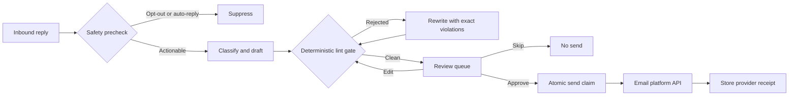

# Cold Email Reply Assistant

A human-in-the-loop inbox workflow that classifies prospect replies, drafts a concise response, blocks AI writing tells, and sends only after approval.

## Why I built it

Cold email replies lose value when the answer is late, generic, or sent without context. I built this to cut the response time while keeping the sender responsible for the final message. The system handles repetitive drafting, but it does not get permission to send on its own.

## How it works



- A model classifies each reply as interested, question, objection, not now, unsubscribe, or out of office.
- The drafting prompt isolates the prospect's one specific point and provides only a factual sender profile.
- Every model draft and human edit passes the same deterministic gate.
- SQLite stores the card, all draft attempts, gate violations, approval state, and provider receipt.
- The browser review queue shows the inbound message, the chosen point, the draft, and the complete gate audit.

## Guardrails

- Opt-outs and automatic replies are detected before the model runs. They are stored as suppressed and cannot be approved.
- The lint gate blocks canned openers, corporate AI language, hollow enthusiasm, formal sign-offs, long dashes, call durations, unsolicited links, dense blocks, and the wrong sender sign-off.
- A rejected draft is returned to the model with exact violations. It never reaches the review queue unless a later attempt passes.
- Approval re-runs the lint gate against the current text. A clean result from an older version of the draft is not reused.
- Sending uses an atomic `pending` to `sending` transition and a stable idempotency key. Repeated approval requests return the existing sent card.
- An uncertain provider result moves the card to `needs_verification`. The system does not retry an ambiguous send automatically.
- Live mode requires an app access token. Secrets and sender settings come only from environment variables.

## Quick start

Demo mode uses a fake model, a mocked email API, and six fictional replies. No keys or network calls are required.

```bash
python3 -m venv .venv
source .venv/bin/activate
pip install -r requirements.txt
python -m reply_assistant.demo --reset
uvicorn reply_assistant.web:app --reload
```

Open `http://127.0.0.1:8000`. The question card shows its first draft rejected for AI-style wording, followed by the clean rewrite that entered the queue. Approving a card records a mock provider receipt.

For real use, copy `.env.example` to `.env`, replace every placeholder, and set `APP_MODE=live`.

```bash
cp .env.example .env
# Edit .env before continuing.
set -a
source .env
set +a
uvicorn reply_assistant.web:app
```

The email adapter sends `POST /replies` to `EMAIL_API_BASE_URL` with a bearer token, an `Idempotency-Key` header, and this JSON shape:

```json
{
  "reply_to_message_id": "provider-message-id",
  "thread_id": "provider-thread-id",
  "from": "sender@example.com",
  "to": "prospect@example.com",
  "subject": "Re: original subject",
  "text": "approved reply"
}
```

The provider response must contain `message_id` or `id`. Adapt `HttpEmailClient` if your platform uses a different contract.

## Example output

```text
Demo review queue
==============================================================================
out_of_office   suppressed  Casey Nguyen       lint rejects: 0
unsubscribe     suppressed  Jordan Kim         lint rejects: 0
not_now         pending     Amina Okafor       lint rejects: 0
objection       pending     Theo Martin        lint rejects: 0
question        pending     Priya Shah         lint rejects: 1
  attempt 1 blocked: corporate_ai: replace corporate AI wording [leverage]; hollow_enthusiasm: remove hollow enthusiasm [Great question]
interested      pending     Jamie Rivera       lint rejects: 0
```

All names, companies, addresses, messages, and identifiers in demo mode are fictional.

## Tests

```bash
pytest
```

The offline suite covers lint failures, forced rewrites, opt-out and auto-reply suppression, clean edit enforcement, idempotent approval, skipped cards, and ambiguous provider failures.

## Tech

- Python 3.11+
- FastAPI and vanilla HTML, CSS, and JavaScript
- SQLite
- Anthropic Messages API
- Generic HTTP email platform adapter
- pytest

## License

MIT. Copyright (c) 2026 Christian Terrone.
